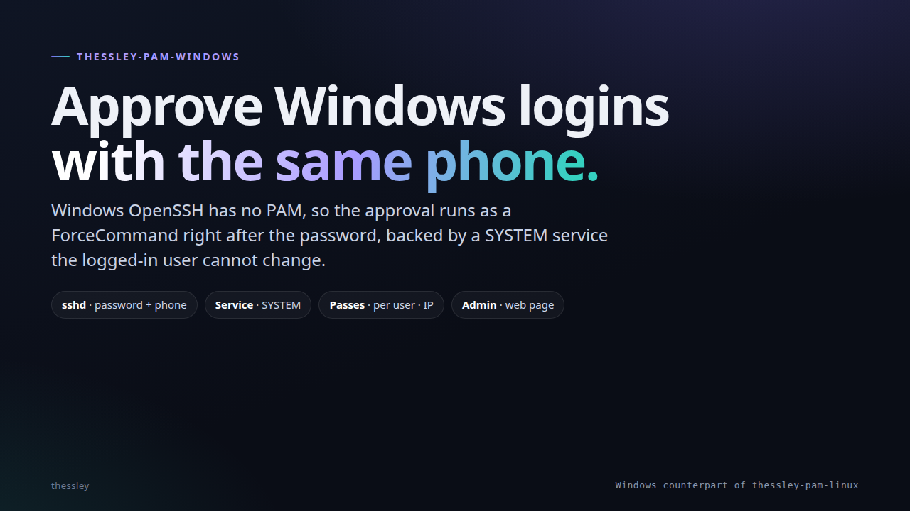
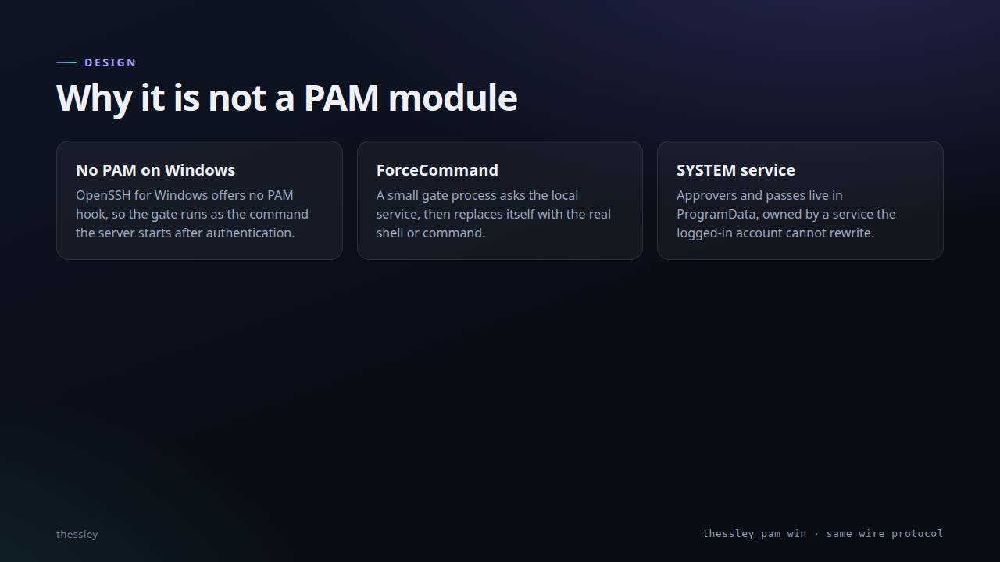

# thessley-pam-windows

**Interactive deck:** [netmate1234.github.io/thessley-presentations/pam-windows](https://netmate1234.github.io/thessley-presentations/pam-windows/) — arrow keys or click the edges.

| How it works | Trust model |
|:---:|:---:|
|  |  |

Approve ssh logins to a **Windows 11** computer with the Thessley Passkey phone app or desktop app: the account's password
first, then a QR code and a `thessleypam://` link that a phone (or the desktop app) approves with a signature.

It is the Windows counterpart of `thessley-pam-linux` and speaks the same protocol (`thessley_pam_v1`), so the same
apps work. Windows OpenSSH has no PAM, so the approval runs as a `ForceCommand` right after the password; a small service
running as SYSTEM keeps the approvers and passes where a logged-in user cannot change them.

Read [docs/SSH.md](docs/SSH.md) first: it explains the design, the limits, the setup and what has and has not been tested.

| Piece | What it does |
|---|---|
| `thessley_pam_win/gate.py` | what sshd runs instead of the shell; asks the service, then starts the shell or command |
| `thessley_pam_win/daemon.py` | the approval service (SYSTEM, `127.0.0.1:47800`) |
| `thessley_pam_win/approve.py` | the approval flow: link, QR code, signed answer, passes |
| `thessley_pam_win/cli.py` | `thessley-pam-win enroll / list / remove / grace / passes / status / sshd-config` |
| `thessley_pam_win/store.py`, `grants.py` | approvers and passes under `C:\ProgramData\ThessleyPamWin` |
| `thessley_pam_win/web.py` | the admin web page: sign in with an approval, manage your approvers, settings, activity ([docs/WEB.md](docs/WEB.md), has the Windows steps) |
| `thessley_pam_win/enroll.py`, `peer.py` | adding an approver (shared by the admin tool and the service); finding out which Windows account is on the other end of a local connection |
| `thessley_pam_win/protocol.py` | **copied unchanged** from thessley-pam-linux (`05065e3`); keep byte-identical with the Android app |
| `thessley_pam_win/listener.py` | exclusive-use HTTPS listeners for the web page and the daemon's shared, concurrent SSH approval listener |
| `install/install.ps1`, `uninstall.ps1` | administrator scripts: service, folder permissions, optional firewall rule |

Needs Python 3.10+ installed for all users, plus `cryptography` and `qrcode`. Tests: `pip install -e .[test]` then `python -m pytest`.